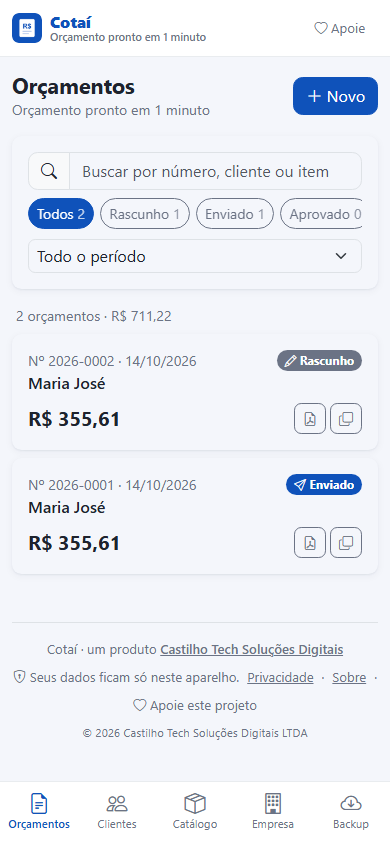
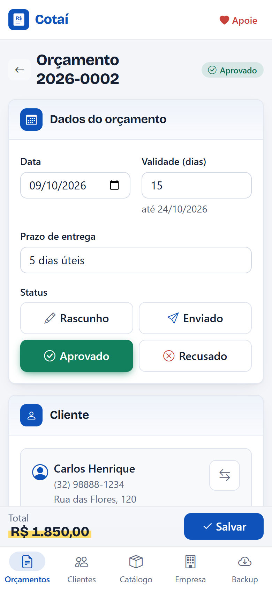
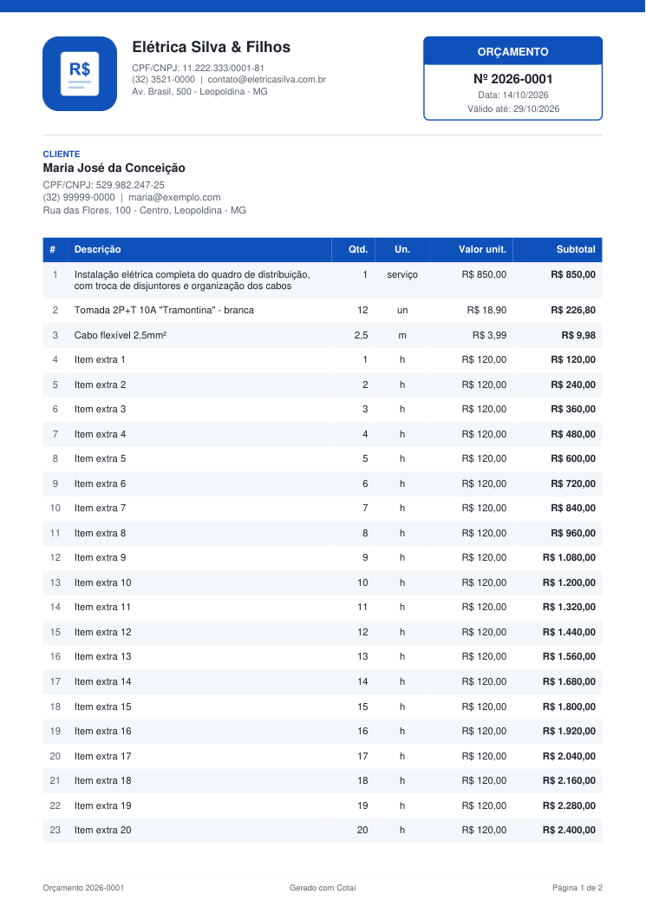

<p align="center">
  
</p>

<h1 align="center">Cotaí</h1>
<p align="center"><strong>Orçamento pronto em 1 minuto.</strong></p>

<p align="center">
  <a href="https://cotai-orcamentos.pages.dev"><strong>Acessar o app →</strong></a>
</p>

<p align="center">
  
  
  
  
  
</p>

<p align="center">
  
  
  
</p>

## Sobre o projeto

O **Cotaí** é um aplicativo web gratuito para pequenos negócios e profissionais autônomos (eletricistas, oficinas,
lojas, prestadores de serviço e freelancers) criarem **orçamentos profissionais em PDF** e enviarem para o cliente
pelo **WhatsApp**, tudo pelo celular.

Muitos desses profissionais ainda fazem orçamentos à mão, em mensagens soltas ou em planilhas difíceis de usar no
celular. O resultado parece amador, dá trabalho refazer cálculos e fica difícil acompanhar o que foi aprovado. O Cotaí
resolve isso com um fluxo direto: **cadastrar os itens uma vez, montar o orçamento em poucos toques e enviar um PDF com
a cara da empresa**.

Três princípios guiaram o projeto:

- **Simples de verdade.** Sem cadastro, login ou configuração. Abriu, usou.
- **Privacidade por padrão.** Não existe servidor: todos os dados ficam no próprio aparelho do usuário.
- **Funciona em qualquer lugar.** É um PWA instalável que funciona **offline**, ideal para quem orça na obra, na rua ou
  no balcão.

## Funcionalidades

**Orçamentos**
- Numeração sequencial automática por ano (`2026-0001`, `2026-0002`...)
- Itens do catálogo ou avulsos, com quantidade decimal (ex.: `2,5 m²`), unidade, valor unitário e subtotal
- Desconto em R$ ou %, frete/acréscimo e total calculado em tempo real
- Data, validade, prazo de entrega, condições de pagamento e observações
- Acompanhamento por status (rascunho, enviado, aprovado e recusado) e duplicação de orçamentos
- Lista com busca, filtro por status e por período, e soma dos valores filtrados

**PDF e envio**
- PDF profissional gerado **no próprio navegador**, com logo, cor da marca, dados da empresa e do cliente, tabela de
  itens, totais, condições, validade e espaço para assinaturas
- Envio do PDF como arquivo pela **Web Share API** (o menu "compartilhar" nativo do celular)
- Botão de WhatsApp com resumo do orçamento já formatado
- O status passa para "Enviado" automaticamente ao compartilhar

**Cadastros**
- Dados da empresa: logo (reduzida automaticamente), cor do PDF, contato e textos padrão
- Clientes com busca, podendo ser cadastrados direto na tela do orçamento
- Catálogo de produtos e serviços para montar orçamentos mais rápido

**Dados e apoio**
- Backup e restauração completos em JSON
- Página de apoio ao projeto com **QR Code Pix** e código copia e cola gerados localmente

## Stack

| Camada | Tecnologia |
|---|---|
| Interface | **Vue 3** (Composition API, `<script setup>`) + **Vite** |
| Estilo | **Bootstrap 5** via Sass (tema customizado, sem jQuery e sem o JS do Bootstrap) + Bootstrap Icons |
| Estado | **Pinia** |
| Rotas | **Vue Router** (com carregamento sob demanda das telas) |
| Persistência | **IndexedDB** com **Dexie** |
| PDF | **jsPDF** + **jspdf-autotable** |
| QR Code | **qrcode** |
| PWA / offline | **vite-plugin-pwa** (Workbox) |
| Hospedagem | **Cloudflare Pages** (site estático, deploy contínuo a partir do GitHub) |

## Destaques técnicos

- **Arquitetura offline-first e sem backend.** O app é 100% estático. Todos os dados vivem no IndexedDB do navegador,
  com pedido de armazenamento persistente, e o service worker guarda o app para uso sem internet. Em tempo de execução
  o app não faz nenhuma chamada de rede com dados do usuário.
- **Dinheiro em centavos inteiros.** Todos os valores são calculados e armazenados como inteiros, evitando os erros
  clássicos de ponto flutuante (`0,1 + 0,2`). A formatação usa `Intl.NumberFormat` e `Intl.DateTimeFormat` em pt-BR.
- **Pix BR Code implementado do zero.** O payload "copia e cola" segue o padrão EMV do Banco Central, com o checksum
  **CRC16-CCITT** calculado no app e validado contra o exemplo oficial do manual do Pix.
- **CNPJ alfanumérico.** A validação de documentos já suporta o novo formato de CNPJ com letras, vigente desde julho de
  2026, além de CPF e CNPJ numérico, com máscaras que se adaptam ao tipo digitado.
- **Numeração à prova de conflitos.** O número do orçamento é reservado numa transação do banco apenas ao salvar, então
  rascunhos descartados não "queimam" números, e backups importados não geram duplicidade.
- **Histórico preservado.** Cada orçamento guarda uma cópia dos dados do cliente; editar o cadastro depois não altera
  um orçamento já enviado.
- **Carregamento leve.** As bibliotecas de PDF (a parte mais pesada) só são carregadas quando necessárias, e já em
  segundo plano ao abrir um orçamento. Cada tela também é carregada sob demanda, então a abertura do app baixa só o
  necessário.
- **Compartilhamento robusto.** Navegadores exigem um toque recente do usuário para compartilhar arquivos. Se gerar o
  PDF demorar e essa permissão expirar, o app pede um toque de confirmação; sem suporte à Web Share API, o PDF é baixado.
- **Mobile-first.** Navegação inferior no celular e superior no desktop, campos com teclado adequado (numérico,
  telefone, e-mail) e um campo de moeda no estilo dos apps de banco, em que os dígitos preenchem da direita para a esquerda.

## Estrutura

```
src/
├─ views/         # telas: orçamentos, editor, clientes, catálogo, empresa, backup, sobre, privacidade
├─ components/    # editor de itens, totais, seletor de cliente, modais, campos com máscara
├─ stores/        # estado global (Pinia): empresa, clientes, catálogo, orçamentos, interface
├─ composables/   # geração de PDF, compartilhamento, backup
├─ utils/         # Pix (BR Code + CRC16), CPF/CNPJ, máscaras, formatação, cálculos
├─ db/            # esquema do banco local (Dexie)
└─ config.js      # dados configuráveis (Pix, contato, nome do app)
```

## Autor

Desenvolvido por **Augusto Castilho**, da **Castilho Tech Soluções Digitais**, empresa de Leopoldina/MG especializada em
software sob medida, automações e consultoria em tecnologia para pequenos e médios negócios.

- Instagram: [@augustocastilho_dev](https://www.instagram.com/augustocastilho_dev/)
- WhatsApp: [(32) 99966-9302](https://wa.me/5532999669302)

Precisa de um sistema sob medida para o seu negócio? **[Fale comigo no WhatsApp](https://wa.me/5532999669302)**
